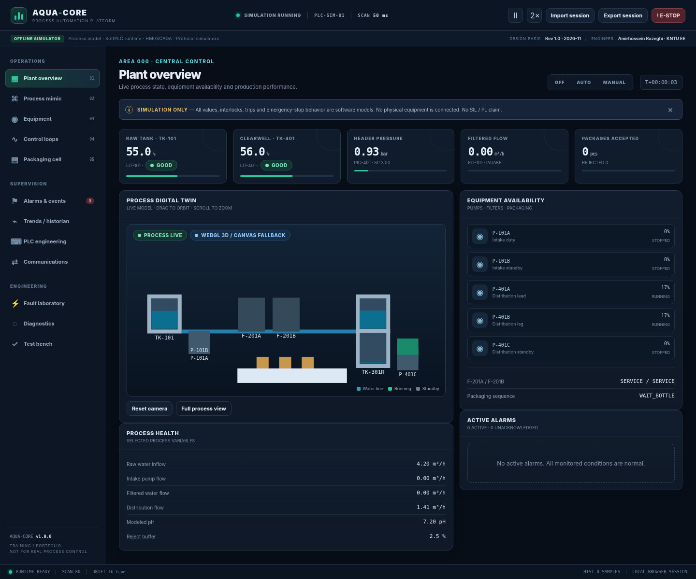
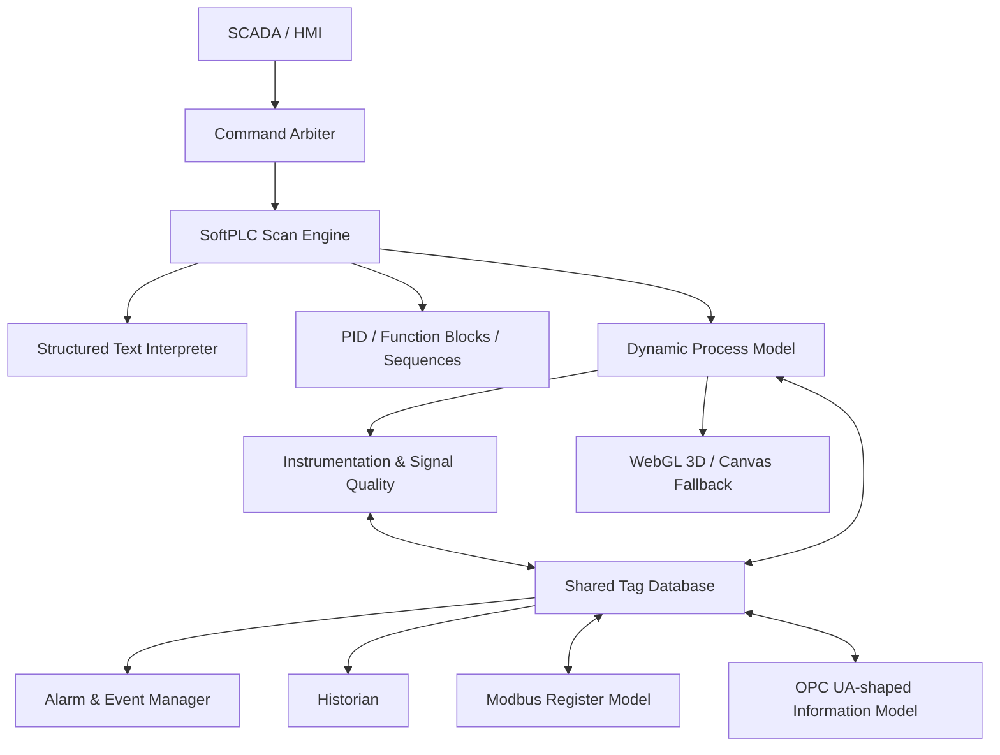

# AQUA-CORE

**Industrial Process Automation & Digital Twin Platform**  
*A browser-based process simulator, SoftPLC/ST runtime, SCADA/HMI, instrumentation and industrial-protocol laboratory.*



> **Training / portfolio software only.** AQUA-CORE is an educational browser simulation. It is not a certified PLC, SCADA, safety system, process design package, or substitute for an engineered installation. No physical process is connected.

## What it demonstrates

AQUA-CORE models a water-treatment and distribution plant with a small packaging cell. A shared tag database connects process dynamics, field instrumentation, a logical PLC scan, HMI, alarms, historian, a Modbus register model and an OPC-UA-shaped information model.

- **Process model:** raw-water and clearwell tanks, intake and distribution pumps, dual filters, valves, dosing/pH proxy, pressure header and packaging sequence.
- **SoftPLC scan engine:** 50 ms logical scan target, command arbitration, OFF/AUTO/MANUAL modes, permissives, interlocks, trip latch and diagnostics. Browser scheduling is not hard real-time.
- **Structured Text subset:** lexer, parser and interpreter for a deliberately bounded IEC 61131-3-inspired subset. Supported grammar and limitations are described in [`docs/ST-LANGUAGE-SUBSET.md`](docs/ST-LANGUAGE-SUBSET.md). This is not a complete IEC 61131-3 runtime.
- **Control loops:** LIC-101, FIC-201, PIC-401 and AIC-301 PID controllers with tuning, Auto/Manual mode, output limits and anti-windup behavior.
- **Equipment & instrumentation:** modeled pump/valve/filter states, analog/digital tags, signal quality and fault injection.
- **SCADA/HMI:** overview, process mimic, equipment, loops, packaging, alarm/event list, trends, PLC engineering, communications, fault lab, diagnostics and test bench.
- **Historian:** bounded in-memory sample buffer with CSV export.
- **Protocol laboratory:** Modbus register/coil/discrete model, function-code helpers, exception responses and MBAP frame codec; OPC-UA-shaped in-memory nodes with read, browse and local subscription callbacks.
- **Digital twin:** native WebGL 1 rendering of simplified 3D process geometry with orbit/zoom controls when WebGL is available; a Canvas 2D isometric fallback is used when WebGL is unavailable. No Three.js, CDN or remote font is required.
- **Fault laboratory:** 27 repeatable scenarios across process, instruments, drives, packaging and protocol/data services.
- **Validation:** 31 in-app unit, integration and protocol tests.

## Run it

### No-install / offline run

1. Download or clone this repository.
2. Open `index.html` in a modern desktop browser.
3. No package manager, build step, server, database, CDN, remote runtime dependency or internet connection is required.

The app uses classic relative script and stylesheet paths, so it can be opened directly from disk and published as a GitHub Pages static site. Browser privacy settings may disable `localStorage`; the application continues in memory-only mode. A browser with WebGL enabled uses the 3D renderer; otherwise the 2D fallback is selected.

### GitHub Pages deployment

A deployment workflow is included at [`.github/workflows/pages.yml`](.github/workflows/pages.yml). It uploads the static repository as a GitHub Pages artifact and deploys it through GitHub Actions. No build step is needed.

1. Create a GitHub repository (for example, `AQUA-CORE`) and push the contents of this folder to the default branch named `main`.
2. Open **Settings → Pages** in the repository.
3. Under **Build and deployment → Source**, select **GitHub Actions**.
4. Push to `main`, or run **Deploy GitHub Pages** manually from the Actions tab.
5. When the workflow succeeds, open the URL shown in the `github-pages` deployment environment. A project site normally has the form `https://<account>.github.io/<repository>/`.

See GitHub's [publishing-source guide](https://docs.github.com/en/pages/getting-started-with-github-pages/configuring-a-publishing-source-for-your-github-pages-site) and [custom workflow guide](https://docs.github.com/en/pages/getting-started-with-github-pages/using-custom-workflows-with-github-pages) for current repository settings and deployment behavior.

## First-use operating guide

1. Start on **Plant overview**. Observe tank levels, flows, header pressure, pump states and the live alarm summary.
2. Open **Process mimic**. Drag to orbit the 3D view and use the mouse wheel to zoom. If WebGL is disabled, the isometric Canvas fallback remains available.
3. Use **Control loops** to adjust a setpoint or PID tuning parameter within its engineering bounds.
4. Open **Equipment** and select **MANUAL** before using manual jog controls. Requests pass through command arbitration and remain subject to interlocks/trip inhibition.
5. Enable the **Packaging cell** to run the bottle index/fill/inspect/cap/reject sequence.
6. Open **Fault laboratory** and inject one fault at a time. Observe tag quality, equipment state, alarms and process response. Clear the fault after the test.
7. Press **E-STOP** to latch the simulated trip. Releasing the simulated E-STOP does not restart the plant; reset the trip deliberately and issue a new start request.
8. Use **Trends / historian** to inspect sampled values and export CSV. Use **Export session** and **Import session** to save or restore a JSON snapshot.
9. Open **Test bench → Run all tests**. The current reference suite contains 31 checks and is expected to report 31 PASS / 0 FAIL.

## Operating modes

| Mode | Behavior |
|---|---|
| `OFF` | Automatic process commands are restricted. |
| `AUTO` | Sequencing, interlocks and PID-derived commands operate the simulated plant. |
| `MANUAL` | Operator jog requests are enabled for supported equipment; permissives and trip inhibition remain active. |
| `TRIPPED` | Internal latched state entered after the simulated E-STOP or a modeled major trip; outputs are inhibited until the reset sequence completes. |

**Simulated E-STOP recovery:** clear the initiating condition → release/reset the simulated E-STOP input → issue `RESET_TRIP` → select the required mode → issue a new start request. The sequence intentionally does not auto-restart.

## Architecture



Detailed engineering notes, CSV schedules and the validation report are in [`docs/`](docs/). The Persian engineering design specification is included in [`docs/engineering-specification/`](docs/engineering-specification/), with architecture and process diagrams in [`docs/diagrams/`](docs/diagrams/).

## Repository layout

```text
AQUA-CORE/
├── index.html
├── assets/                  # local favicon and visual assets
├── config/                  # process constants and tag definitions
├── css/                     # theme and application styles
├── js/
│   ├── core/                # event bus, clock, tag DB, command arbiter
│   ├── process/             # tank, pump, valve, filter and plant models
│   ├── instrumentation/     # signal conditioning and quality model
│   ├── plc/                 # scan engine, ST runtime, PID, FBs and sequences
│   ├── scada/               # HMI, alarm manager and historian
│   ├── communications/      # Modbus simulator and OPC-like data model
│   ├── digital-twin/        # native WebGL renderer and 2D fallback
│   ├── packaging/           # packaging cell controller
│   └── testing/             # fault injection and in-app tests
├── docs/                    # engineering notes, CSV schedules and test evidence
├── tools/                   # optional developer smoke-test harness
└── .github/workflows/       # GitHub Pages deployment workflow
```

## Engineering boundaries & honest implementation status

| Topic | Implemented in this repository | Not implemented / not claimed |
|---|---|---|
| PLC | JavaScript scan engine and documented ST subset interpreter | Vendor PLC runtime, full IEC 61131-3 conformance or hard real-time execution |
| Safety | Software interlocks and a latched simulated E-STOP | Safety PLC, SIL/PL rating, risk assessment or safety validation |
| Modbus | In-memory data model, function-code operations, exceptions and MBAP encode/decode helper | Raw Modbus TCP socket, port 502 listener, network client/server gateway or field-device connection |
| OPC UA | Address-space-shaped node model, read/browse and local subscription callbacks | OPC UA server endpoint, discovery, certificates, security policies or wire protocol |
| Digital twin | Process-synchronized native WebGL geometry with Canvas fallback | CAD-grade geometry, calibrated physics or validated physical twin |
| Process | Educational first-principles-inspired approximations | Vendor sizing, hydraulic design, chemical dosing design, process guarantees or calibration |
| Historian | Bounded in-memory time series and CSV export | Durable enterprise historian, SQL database, time synchronization or audit-grade retention |

The browser cannot open arbitrary raw TCP sockets. A real Modbus TCP connection would need an external gateway/bridge and a defined security boundary. A real OPC UA endpoint likewise requires a server/gateway. These functions are intentionally outside the browser-only build.

## Validation

- Every JavaScript source file is syntax-checked with Node.js during development.
- Browser smoke-tested in Chromium: all 12 HMI routes loaded and the 31 in-app checks passed with no browser page errors in the recorded run.
- In-app test results are available from **Test bench** and can be exported as JSON.
- Optional developer harness: `tools/smoke-test.py` (requires the developer-only dependency listed in `tools/requirements-dev.txt`).

The Chromium test environment used for this build did not expose WebGL, so its browser run exercised the Canvas fallback. The native WebGL renderer is included but was not independently GPU-verified in that environment. Please check it in a current desktop browser with WebGL enabled. A passing software test suite is not process or safety validation.

## Standards-informed design references

The terminology and model boundaries are informed by IEC 61131-3 concepts, the Modbus Application Protocol, OPC UA information modeling, ISA instrument identification/HMI/alarm-management practices and NIST OT security guidance. This repository is **not certified or formally assessed as compliant** with those standards.

- [Modbus specifications](https://www.modbus.org/specs.php)
- [OPC UA reference](https://reference.opcfoundation.org/)
- [ISA standards](https://www.isa.org/standards-and-publications/isa-standards)
- [NIST SP 800-82 Rev. 3](https://csrc.nist.gov/pubs/sp/800/82/r3/final)

## License

Released under the MIT License. See [`LICENSE`](LICENSE).

## Author

**Amirhossein Razeghi** · Electrical Engineering, KNTU  
AQUA-CORE is an independent educational/portfolio project.
